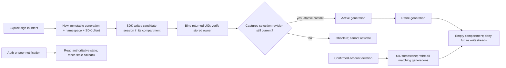

# R4-SEC-11 — Isolated Auth session generations: executable PoC

Date: 2026-10-23. Base: `3aa3fcf4711b25b3432c77a2680277980b75757f`
(latest main, PRs #47–#50 merged). **Experiment only; not deployed.**

**Recommendation: CONDITIONAL GO for a separately reviewed implementation plan.
Do not integrate this PoC into Production.** Immutable generations plus atomic
storage admission protected B in the executed SDK and native browser cases.
This is substantially more than changing a storage key. Legacy rollout,
storage-failure handling in SDK 2.83, lifecycle resource disposal and complete
application data-access integration remain release blockers.

No production source, existing tests, dependencies, CI, SQL, RLS, privileges,
Auth configuration or real data changed. No hosted Supabase connection,
credentials, real account deletion, deployment or merge was used. All passwords,
tokens, UIDs and HTTP responses are synthetic. No new service is required for
the local architecture; remote revocation is a separate question.

## Evidence and boundaries

Reviewed [R4-SEC-10](r4-sec-10-auth-session-retirement-review.md),
[F4](r4-sec-09-local-recovery-erasure.md),
[F1–F3](r4-sec-08-account-deletion-lifecycle.md),
[database deletion audit](r4-sec-06-account-deletion-security-review.md), and
the current singleton, AuthProvider/context, App, UserProfile, accountDeletion
and recoveryStorage lifecycles. The existing application still uses its shared
client. Nothing in this experiment changes those lifecycles.

Executed versions: Windows x64, Node **24.22.0**, pnpm **10.34.6**,
`@supabase/supabase-js` and `@supabase/auth-js` **2.83.0** from the existing
lockfile/install, native **Chrome 155.0.8059.85**. The SDK source and its
SHA-256 are recorded in R4-SEC-10; no upgrade was made.

| Evidence category | What actually ran | What it does not prove |
| --- | --- | --- |
| Real installed SDK + deterministic simulations | Public SDK methods, fake HTTP, a serialized transactional storage model and controlled lock gates | Browser persistence, real Auth acceptance or network authorization |
| Real browser/IndexedDB | The same 24 groups with native IndexedDB transactions, real SDK, controlled SDK lock scheduling | Disk power-loss durability or every browser's storage behavior |
| Real browser multi-page | Eight further scenarios using independent page realms, shared-origin IndexedDB, actual Web Locks and BroadcastChannel, page reload and full browser restart | Instantaneous UI agreement in suspended tabs; legacy clients; managed Supabase Auth |
| Fault injection | Denied operations and aborted transactions, with native `IDBTransaction.abort()` in the browser variant | OS quota exhaustion, browser policy denial, eviction, device loss or forensic erasure |

The real-browser harness follows the repository's existing optional CDP harness
approach. It bundles only experiment files and installed SDK code using Vite's
existing esbuild dependency. It serves a loopback-only fixture, uses a fresh
disposable Chrome profile and blocks page network connections with CSP. The SDK
has an injected transport restricted to `https://generation-poc.invalid`; it
never sends HTTP there. No production app/environment file is imported.

## State model and ownership



`GenerationStore` distinguishes `uid`, random generation `id`, immutable
`namespace`, generation-specific SDK instance, `active` ID and monotonic
`selection` revision. A new sign-in begins **unbound**: its UID is not guessed
from the currently displayed account. The SDK main-session write records a
candidate UID; `bind` checks it against the UID returned by sign-in. This also
lets confirmed deletion retire an A candidate that has persisted before its
sign-in promise reaches binding. A late new A write after the account tombstone
is refused. No `user_metadata` value is used for ownership or authorization.

Binding alone cannot select a session. Activation compares the selection
revision captured when that intent began, inside the storage transaction. A
sign-in that began before B's activation cannot replace B when it finishes late.
The user must start a new explicit intent rather than silently retrying with a
fresh revision. Reload restores the current selection; it never reactivates an
old saved intent. Generation IDs cannot be reused.

Retiring one generation leaves another generation of the same UID intact.
**Confirmed account deletion** instead installs a UID tombstone and retires all
its bound/candidate generations, including a newer A after A → B → A. That
distinction is explicit, not inferred from a stale dialog. Retiring A never
selects a retained B automatically: a new sign-in intent is required if there
is no active generation. No SDK signOut is part of the local retirement method.

Every adapter is bound to its exact generation/namespace. All opaque keys passed
by that SDK live inside that compartment. Erasure empties our compartment;
it never guesses/deletes private SDK companion keys or sweeps origin storage.
Raw main-session UID validation is a local ownership consistency check, **not
JWT validation or a substitute for server authorization/RLS**. Same-origin
malicious JavaScript can bypass this entire cooperative protocol.

## Transaction boundaries

The PoC deliberately uses one small IndexedDB record with schema version 1:
selection revision, active ID, generation records and retired UID markers.
Each operation opens a short `readwrite` transaction, reads that record, checks
ownership/retirement, mutates synchronously and writes the record. Results are
returned only at `oncomplete`. Throws or aborts leave the previous state intact.
A callback returning a Promise is rejected; no network await occurs inside a
transaction. Whole-record storage simplifies proof, but is not a scalable
production schema or a fully validated migration format.

Atomic operations include activation, candidate/bound ownership checks, write
admission, generation retirement, account tombstone plus credential removal,
and the active-generation check for data requests. Concurrent writers serialize
against retirement: a write before retirement is erased, a write after it cannot
recreate credentials. Both deterministic orders and a native cross-page race
were executed. Notification delivery is outside the transaction and has no
authority to modify storage.

On storage denial/abort the operation reports failure, not verified erasure.
The initiating manager immediately blocks its own retired generation in memory;
other realms cannot be guaranteed to observe a retirement that did not commit.
Reads/data access with inaccessible storage fail closed. Retrying **local
retirement** is possible and does not repeat an account-deletion RPC. Residual
bytes in a failed transaction are asserted, not hidden.

## SDK integration and the failed initial design

Supported public options used: custom `storage`, unique `storageKey`, injected
`fetch`, and controlled `lock` for deterministic cases. Public methods include
`initialize`, `signInWithPassword`, `getSession`, `refreshSession`, `signOut`,
`onAuthStateChange` and `stopAutoRefresh`. Native multi-page runs use the SDK's
actual Navigator Locks implementation. Auto-refresh scheduling and URL session
discovery are disabled in the fixture; explicit refresh exercises the installed
refresh implementation. This does not validate every automatic scheduler/URL
flow or propose disabling them in Production.

Auth callbacks are synchronous signals. They never await another SDK call,
trust the event's session identity, activate a generation or remove credentials.
The manager asynchronously reads committed storage and uses a sequence guard
against older snapshot completions. Tests observe actual SIGNED_OUT, SIGNED_IN
and TOKEN_REFRESHED callbacks while verifying B's exact stored strings, SDK
identity, active pointer and manager view.

**Failed experiment retained:** the initial storage adapter rejected a retired
refresh write with an Error. Even though the caller caught the public
`refreshSession()` rejection, auth-js 2.83's internal refresh deferred also
rejected without a consumer. Node exited 1 after the isolation assertions passed.
That is an SDK integration failure, not a passing run. The standalone
`rejected-storage.mjs` reproduces it; the main runner checks the child's nonzero
exit, caught-public-rejection marker and exact error marker. No process-level
unhandled-rejection suppression was added.

The final SDK-facing adapter discards **only a typed, verified retired write**
and counts it. The underlying storage contract still rejects such writes. This
lets the old SDK finish emitting its obsolete success without resurrecting
credentials. Its result is not application authority: binding/current checks
and committed selection decide usability. A caller must not publish raw SDK
success/session payloads. Real storage/ownership errors are not converted to
success; the SDK's uncaught-deferred behavior remains a **production blocker
for general storage failures** until separately resolved and tested. Do not
install a blanket rejection handler or swallow all storage errors as a fix.

The four unsafe shared-client controls reproduce B removal for queued logout,
in-flight logout and refresh failure, and B replacement by A after refresh
success. The queued logout even sends B's token; the in-flight one sends A's
token but removes B's current slot. With immutable clients the same API cannot
switch its namespace/token source to B.

## Authenticated application data boundary

`GenerationManager.words(entry)` demonstrates actual Supabase query construction
against the fake REST transport. It validates the captured generation is active,
pins its session's Authorization header and UID filter, and revalidates the
generation/revision after the response before publishing data. A held A request
remains A-authenticated after B signs in; its eventual response is discarded
while B's response remains visible. A new request through an obsolete A entry
is rejected without HTTP. Storage denial likewise dispatches no data request.

**Second failed draft, corrected in this PoC:** a deliberately delayed result
from the *post-response* storage check could contain A's old valid selection,
even after this manager had already selected and rendered B. Checking that
snapshot alone then published A's rows over B. New group 24 failed with an
exact-equality assertion before correction. The final boundary also checks the
manager's current generation/revision synchronously, immediately before
dispatch/publication. The same regression now runs against both engines and
requires A's result be discarded and B's rows remain exact. This demonstrates
why a storage transaction alone is not a React/UI completion fence; it is not
evidence of a defect in the unchanged production application.

An already-authorized request can become obsolete immediately before or during
dispatch; it is not retroactively cancelled. It still uses A, never B. These
guards prevent stale publication, not server-side effects of an in-flight write.
Future integration must capture a capability for **every** Auth/data operation;
changing only AuthProvider while components still use the global singleton
would leave a gap. The synthetic transport checks UID/header agreement but
does not emulate JWT cryptography, PostgREST authorization or actual RLS.

## Native multi-tab, reload and restart findings

All eight native scenarios passed on three final fresh-process runs:

1. A logout genuinely pending behind a native Web Lock while B signs in through
   its independent generation; the harness asserts both held and pending locks.
2. A HTTP logout response withheld while B becomes active.
3. A successful refresh response delivered after B activation and A retirement.
4. A terminal refresh failure delivered under the same ordering.
5. A stale sign-in intent and a forged peer deletion message leave B unchanged.
6. Two page realms concurrently write A/retire A using real IDB transactions;
   all A candidates become unreadable/unwritable, B remains byte-identical.
7. Actual page reload restores exact B and rejects retired A activation.
8. Graceful **full Chrome process exit and relaunch**, same disposable profile
   and loopback origin, restores B and persistent A retirement; new sign-in to
   the tombstoned synthetic UID is rejected.

BroadcastChannel messages are actually delivered, deliberately delayed at the
application listener, then drained. Their payload is ignored. While delivery is
paused, a tab can display an old view; its next data operation still reads the
authoritative state and is rejected. This is **eventual UI convergence, not
instantaneous cross-process revocation of rendered pixels**. A suspended tab,
lost signal, BFCache and focus/resume synchronization need production acceptance
tests and explicit resync hooks. Same-origin tabs need not be separate OS
renderer processes; the test proves independent realms sharing native APIs.

Graceful restart does not prove crash/power-loss durability or resistance to
storage eviction. Normal IDB commit semantics are used; no claim of forensic
erasure, disk flush guarantees, backup removal or deletion of in-memory tokens
is made. SDK 2.83 has no public complete `dispose`; the manager unsubscribes its
listeners/stops scheduling but cannot publicly destroy all internal channels.
Its namespace contains late callbacks. Resource growth and retained in-memory
credentials over long sessions need a supported lifecycle design before release.

## Legacy shared-slot transition — design only

No legacy SDK bytes were read, copied or removed by the experiment.

1. A separately reviewed release must inventory the explicitly configured
   legacy client/storage contract, including URL/companion writers and service
   worker caches. Detect the **known configured** shared slot through that
   version's adapter, not substring guessing. Treat unreadable/ambiguous data as
   migration incomplete. Do not blindly import a parsed `user.id` as authority.
2. Prefer fresh sign-in into a new unbound generation. Initialize a versioned
   app-owned migration marker transactionally and never boot the legacy client
   in the new application. A failed bind/activation leaves the new UI signed
   out with an actionable error; never roll credentials back into the old slot.
3. New-version tabs can cooperate through the new schema/revision protocol.
   Existing old-version tabs cannot be forced to obey a marker they do not
   understand. A broadcast/reload prompt is advisory. Require all old tabs to
   close/update before claiming legacy cleanup; caches/offline clients and
   mixed-version startup require a separately designed rollout gate. A marker
   alone does not establish that gate.
4. **A new storage key does not erase the old session.** Legacy localStorage has
   no cross-tab compare-and-remove transaction. After *verified* quiescence,
   use a separately approved owner-checked legacy cleanup path through a
   supported adapter/client. Do not append shared signOut to A deletion or
   erase the legacy slot merely because A was deleted: it may contain B. If
   quiescence/ownership cannot be established, retain/report residual legacy
   credentials and withhold a complete-erasure claim.
5. If persistent storage is unavailable, fail closed and report persistence/
   retirement unavailable. An explicit nonpersistent mode would require its
   own product decision; it cannot promise cross-tab/restart retirement. Do not
   silently fall back to the shared legacy slot.
6. Rollback must remain generation/tombstone-aware and refuse legacy automatic
   restoration. Rolling back to an arbitrary pre-migration app could resurrect
   its surviving shared-slot credentials. Preserve retirement records and
   require fresh sign-in; never restore credentials from backups to make
   rollback convenient. An incomplete migration is a blocked cutover, not
   permission for broad storage deletion.

The transition is feasible for cooperating new clients, but unmodified old tabs
make unconditional same-origin erasure **unproven**. This is a release gate,
not a problem solved by the native restart test.

## Required production work and F1–F4 acceptance gates

This estimate is an engineering planning range, not a measured delivery promise:
roughly **3–5 focused implementation/review PRs, 2–4 engineer-weeks plus manual
acceptance/rollout time**. Legacy constraints or an SDK change could increase it.

| Workstream | Required scope and evidence |
| --- | --- |
| Storage and SDK lifecycle | Typed validated schema, transactional adapter, fail-closed errors, safe expiry/refresh policy, abandoned-generation cleanup, tombstone retention, bounded resources and supported SDK disposal. Resolve general storage-rejection behavior. |
| Auth orchestration | Context/API compatibility, sign-in/sign-up, email updates, initial restoration, explicit logout, URL flows, same-UID new sessions, cross-tab/focus/BFCache behavior and UI generation fencing. Do not expose unrestricted raw clients to consumers. |
| Data capability rollout | Words, Practice, Test, History, profile reads/mutations and deletion capture immutable capabilities; test every stale async publication and pinned request. No implicit fallback to the singleton. |
| F1–F4 completion | Preserve exact confirmation, UID-pinned deletion, synchronous single-flight, awaited completion and success/failure/unknown distinctions. Only verified deletion may trigger account retirement, even for obsolete dialogs. Keep existing recovery cleanup and its B isolation; Auth-IDB and recovery-localStorage are different stores, not one atomic transaction. Report partial completion and retry local cleanup only. |
| Migration/release | Versioned legacy cutover, old-tab policy, denied/quota/evicted storage, restart/crash and multiple browsers, rollback that cannot revive retired credentials, manual review and regression suite. |

None of these production workstreams is implemented here. In particular, calling
the PoC's `retire(..., {account:true})` assumes an already-confirmed owner-scoped
success. It does not implement a deletion RPC or classify a network outcome.
The existing F1–F4 code remains the authority until separately approved changes.

## Local removal versus remote revocation

These outcomes must remain separately reported:

- **Local credential removal:** empty only A's transactional compartment and
  deny future admitted writes/restoration. Tested within stated assumptions.
- **Supabase refresh-session revocation:** synthetic `/logout` responses prove
  which token the SDK sends, not that managed Auth revoked a session. No live
  revocation, Edge Function, paid feature or new RPC was added.
- **Access JWT rejection:** local removal cannot invalidate an issued/copied
  JWT. Existing expiry, RLS and live-session/user checks are server concerns.

If the latter two become mandatory, first use a disposable full Auth environment
to verify deletion cascades, session/token rotation, logout scope, lost responses,
post-deletion refresh and JWT acceptance on sensitive endpoints. Evaluate a
server-enforced live-session/user boundary separately, preserving ownership and
without placing privileged keys in the browser. The minimal SQL fixtures do
not model managed Auth; the native browser fixture does not replace that review.

## Files and reproduction

| New file under `experiments/r4-sec-11/` | Purpose |
| --- | --- |
| `storage.mjs` | Transactional model/native IDB engines and generation store |
| `manager.mjs` | Isolated SDK clients, activation/retirement and sample data capability |
| `fixtures.mjs` | Synthetic transport, lock gates and portable assertions |
| `checks.mjs` | 24 assertion groups reused across model/native IDB |
| `run.mjs` | Node checks, four unsafe controls and failing-design subprocess check |
| `rejected-storage.mjs` | Intentionally nonzero SDK storage-rejection reproduction |
| `browser.mjs` | Isolated page fixture and native notification boundary |
| `native.mjs` | CDP launcher, multi-page scenarios, reload/restart verification |

The ninth new file is this report. Run from the repository root after the normal
frozen dependency install. Node 24 and a locally installed Chrome/Chromium are
required for the shown commands. No environment variables/credentials required.

```powershell
pnpm install --frozen-lockfile
node experiments/r4-sec-11/run.mjs
node experiments/r4-sec-11/native.mjs --browser 'C:/Program Files/Google/Chrome/Application/chrome.exe'
pnpm exec tsc -b
pnpm lint
pnpm test
pnpm build
git diff --check
```

Expected independent summaries:

```text
PASS: 24 isolated generation checks; 4 unsafe shared-client controls; 1 failing-design reproduction.
PASS: 24 native IndexedDB common checks; 8 native multi-page/reload/restart scenarios.
```

Running `node experiments/r4-sec-11/rejected-storage.mjs` directly is expected to
exit **1**, print `PUBLIC_REFRESH_REJECTION_CAUGHT` and then
`Error: POC_STORAGE_REJECTION`. A zero exit would require investigating an SDK/
runtime change. The main runner verifies this negative control and exits zero
only when all expectations hold. Unexpected errors fail normally.

Three final repetitions used fresh Node processes and fresh Chrome profiles for
each run. Scenario ordering uses explicit deferred responses, native lock
admission and browser events. The only polling is bounded Chrome startup
readiness; the CDP watchdog detects hangs, not success. No application test
timeout or worker setting changed. Profiles/logs remain under ignored `tmp/`
and contain only synthetic data; both the loopback server and launched Chrome
are closed by the runner. No existing browser profile is accessed.

## Validation results

| Check | Actual result |
| --- | --- |
| Independent Node PoC, three final fresh processes | 24/24 groups + 4/4 unsafe controls + 1/1 expected failing-design reproduction on each run |
| Native Chrome PoC, three final fresh processes/profiles | 24/24 common groups + 8/8 multi-page/reload/restart scenarios on each run; no recorded unhandled page errors |
| TypeScript `pnpm exec tsc -b` | Passed, zero errors |
| ESLint `pnpm lint` | Passed, zero warnings/errors |
| Existing frontend regression suite | **803/803**, 37/37 files, 80.57 seconds; no intermittent failures observed in this run |
| Production build | Passed, 8.68 seconds; unchanged 525.45 kB JS / 140.82 kB gzip, existing >500 kB chunk warning |
| Experiment syntax | `node --check` passed for all eight `.mjs` files |
| `git diff --check` and scope review | Passed; only the eight experiment files and this report added |

The experiment uses `.mjs`, outside the existing TypeScript/ESLint TS-file scopes
and Vitest's `src` test include. Its executed commands are separate; the 803
application regressions are not being replaced or augmented with a misleading
combined total. Existing CI is unchanged and does not run this optional PoC.
GitHub Actions results and exact final commit will be linked on the PR after
the run completes. PostgreSQL checks run only in CI's disposable local clusters;
no hosted database is needed or authorized by these instructions.

The earlier R4-SEC-10 parallel validation observed three History pagination
timeouts; this run, performed without concurrent build/PoC work, did not. Those
unrelated intermittences are not claimed fixed by an experiment-only PR.

## References and release decision

- [Supabase client/storage options](https://supabase.com/docs/reference/javascript/auth)
  and [initialization](https://supabase.com/docs/reference/javascript/initializing).
- [signOut and scopes](https://supabase.com/docs/reference/javascript/auth-signout),
  [refreshSession](https://supabase.com/docs/reference/javascript/auth-refreshsession),
  [Auth callbacks](https://supabase.com/docs/reference/javascript/auth-onauthstatechange).
- [IndexedDB transaction semantics](https://w3c.github.io/IndexedDB/#transaction-concept).
- [Supabase session lifetime](https://supabase.com/docs/guides/auth/sessions)
  and [sign-out token limitations](https://supabase.com/docs/guides/auth/signout).

Official references can describe newer SDKs. Timing/API conclusions here come
from installed 2.83.0 source and the executed probes, not an assumed newer API.

**CONDITIONAL GO:** core storage/generation isolation is demonstrated in the
enumerated cases, including native transactions and restart. Reject immediate
Production integration, blanket cleanup claims and the failed throwing-adapter
design. Approve at most a separate plan addressing the explicit release gates.
Retain today's F1–F4 safeguards while that plan is reviewed.
